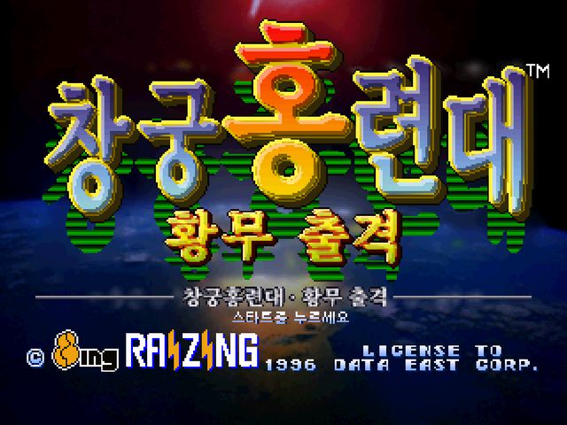
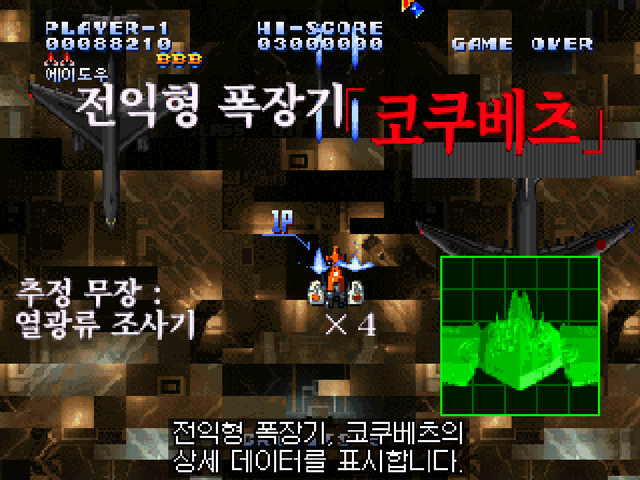
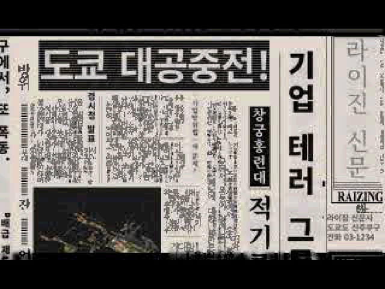
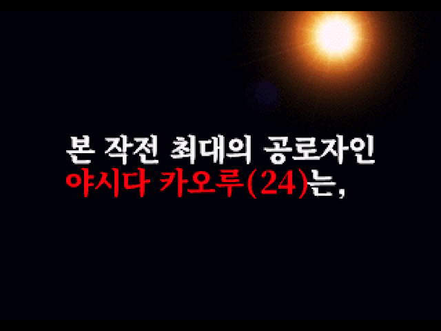
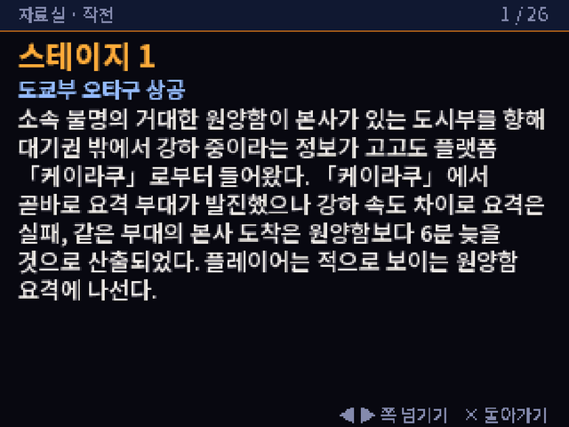
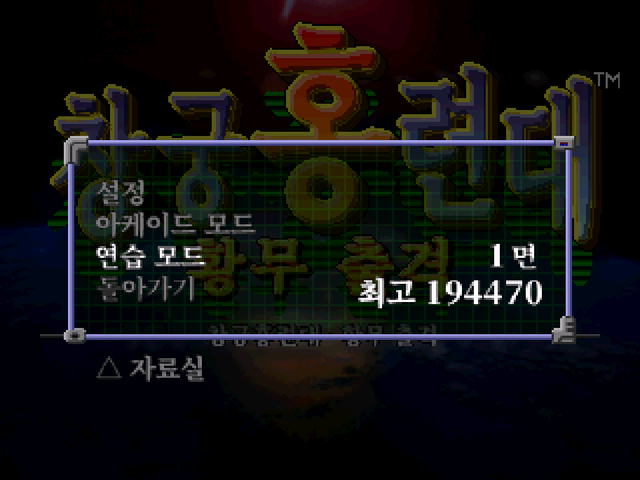
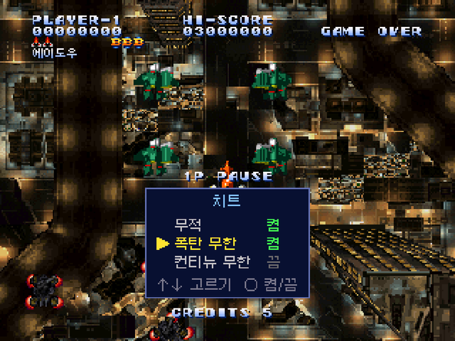

# 창궁홍련대 황무출격 — PS1 한글 패치 v1.0

<p align="center"></p>

1996년 라이징(RAIZING)이 만든 세로 슈팅 게임 **蒼穹紅蓮隊 黄武出撃**(창궁홍련대 황무출격)의 PS1 일본판(SLPS-01172)을 우리말로 옮긴 비공식 팬 패치입니다.

거대 기업이 군대를 거느리고 서로 싸우는 2057년, 주식회사 진성의 사설 부대 「창궁홍련대」의 조종사가 되어 정체불명의 테러 집단과 맞서는 이야기입니다. 이야기 대부분이 작전 설명 음성과 신문·동영상으로 전해지는데, 이 패치는 그 모든 것을 한국어로 즐길 수 있게 하는 데 집중했습니다.

**목표는 '일본어 0개'.** 메뉴부터 신문 본문 한 줄, 동영상 속 글자까지 모두 한글로 바꿨습니다(스태프 이름만 원작 그대로).

**[⬇ 패치 내려받기 (v1.0)](https://github.com/kanx030/soukyuu-gurentai-ps1-kr/releases/tag/v1.0)** · 적용 방법은 [아래](#패치하는-법)를 보세요.

## 특징

### 🗣 한국어 음성 + 모든 음성에 한글 자막
- 오퍼레이터 무전 69줄, 오프닝·클리어·엔딩 동영상의 해설과 대사를 **한국어로 새로 녹음**했습니다.
- 설정의 '음성'에서 **한국어 / 일본어**를 고를 수 있고, 어느 쪽을 골라도 **모든 음성에 한글 자막**이 나옵니다.
- 한국어 음성은 ElevenLabs 목소리 설계(Voice Design)로 새로 만든 목소리이며, 원작 성우의 목소리를 복제하지 않았습니다.

| 작전 설명 | 보스 소개 |
|---|---|
|  |  |

### 📰 화면 속 일본어 전부 한글화
- 한글 타이틀 로고, 메뉴·설정·기체 선택·결과·이어하기 화면, 엔딩 문장.
- **신문**: 제목은 물론 본문·소제목·광고·날짜 줄까지 한국어로 다시 찍었습니다.
- **동영상**: 화면에 찍혀 있던 글자(경고, 영상 자료, 날짜, 신문, 스태프 직책)를 영상 속에서 직접 한글로 바꿨습니다.
- 작은 글자와 자막에는 도트 글꼴 **갈무리(Galmuri)**를 써서 PS1 해상도에서도 또렷하게 읽힙니다.

| 오프닝 동영상 | 신문 |
|---|---|
|  |  |
| **엔딩** | **이어하기** |
|  |  |

### 📚 새턴판의 장점 이식
- **자료실**: 메뉴에서 △. 새턴판에만 있던 설정 자료 18쪽에 황무·조종사 쪽을 더해 모두 26쪽.
- **연습 모드**: 1~7면을 골라 연습하고, 면별 최고 점수를 메모리카드에 기록합니다.

| 자료실 | 연습 모드 최고 점수 |
|---|---|
|  |  |

### 🎮 일시정지 치트 메뉴
- 게임 중 START로 일시정지하면 **무적 / 폭탄 무한 / 컨티뉴 무한**을 켜고 끌 수 있습니다(↑↓ 고르기, ○ 켬/끔, 저장되지 않음).

<p align="center"></p>

## 음성 샘플
눌러서 내려받아 들어 보세요(m4a).

| 샘플 | 길이 |
|---|---|
| [1면 작전 설명 — 오퍼레이터](samples/voice_stage1_briefing.m4a) | 16초 |
| [오프닝 — 특집 방송 해설](samples/voice_opening_narration.m4a) | 42초 |
| [오프닝 — 긴급 무전](samples/voice_opening_operator.m4a) | 13초 |
| [엔딩 — 해설](samples/voice_ending_narration.m4a) | 60초 |

## 표기 기준
- 사람·보스 이름은 일본어 발음(예: 야시다 카오루, 코쿠베츠), 회사·용어는 한자음(예: 팔복성간개발공사, (주)진성).
- 플레이어 기체: 도룡·자전·붕아·황무. 조준망: 핀포인트·에이도우·올레인지·보오류·무소우·랜덤·호우센·오우카.
- 원작의 영어 표시(PLAYER-1, HI-SCORE, CREDITS 등)와 스태프 이름은 원작 그대로 두었습니다.
## 원본 롬 정보 (Redump 기준)
패치는 아래 Redump 덤프에만 맞습니다. 재발매판 *Arcade Hits - Soukyuu Gurentai (Japan)* (SLPM-87255)나 다른 덤프에는 맞지 않습니다.

| 항목 | 값 |
|---|---|
| Redump 이름 | `Soukyuu Gurentai - Oubu Shutsugeki (Japan)` |
| 제품 번호 | SLPS-01172 |
| 기종 / 지역 | Sony PlayStation / 일본 |
| 구성 | CD 1장, 트랙 32개 (데이터 1 + 음악 31) |
| 파일 | `Soukyuu Gurentai - Oubu Shutsugeki (Japan).cue` + `(Track 01).bin` ~ `(Track 32).bin` |

**트랙별 확인값** (Redump 방식: 각 음악 트랙 파일에 앞쪽 2초 공백 포함)

| 트랙 | 종류 | 크기 (바이트) | CRC32 | MD5 | SHA-1 |
|---|---|---|---|---|---|
| 01 | Data | 274511328 | 1B1559D4 | DC0D8E4DAF2A83E826816A81F91D3E17 | 8E4DF26BF94B5F9A2C29B95F5EA43CE7DEC8A02C |
| 02 | Audio | 3142272 | 1D7E2A34 | F3E2B87276087FCCB9C79E705E83F832 | 92BCC9930DC9325D1EC6D763BDEAE98A51DFABFA |
| 03 | Audio | 1434720 | D7867738 | 050EED312417C62B067EE31523E39DC8 | 18B6B2122B5673268C14DF2A89026B4571B7FE7B |
| 04 | Audio | 1458240 | E187C3D3 | A526F17C685C0F620FF6A997A1600061 | 3735B7EB891B2FBABF2808872EA78F0739265BA6 |
| 05 | Audio | 1378272 | E2D5B2E6 | D2B583312B6F7D4F8064A905E017472D | BECB26650B1F5C7E7FD15DA10B614DF7DB01D98E |
| 06 | Audio | 6028176 | 7BAAF303 | D81F1546FA9AE8C4E674CF59B1598D30 | 33D218D7BE4C3B420CC2C760CC6E8EEB2D3BCF7A |
| 07 | Audio | 1514688 | 7E0CCA57 | 85437A51089A5F5E4F342BC1C2881099 | 10C8141CE467A87B94DD51355D8694342D136C47 |
| 08 | Audio | 1648752 | 7EE403C7 | F8EF7DE1D45A0F25AA3A4D4DDACA904F | 6C739E899264470BBC469A823B1AF2837F5D1742 |
| 09 | Audio | 1462944 | 02B96D1F | 196CE56491EFF55E853FDC771571201F | 28A963412EA336583B10EA7D34080508ACC4BFF5 |
| 10 | Audio | 5233200 | D89829EF | 4AFA2B8688BDC5E19172A4235E4AFCE3 | 045C9CA7335623B623C44C3ED933F3E8945EC2F1 |
| 11 | Audio | 1470000 | 1AB24951 | 9316301F0C3539012E52FC7A10E2C0CF | 7D60DFA98780635C8A37F74CE8679817205B3D3B |
| 12 | Audio | 1451184 | 1F731B99 | C61529FAD2DC1FF3EF01B25424BDA54F | 3E02ACB588B89B50F9DE5DC85996448D270B07DF |
| 13 | Audio | 1547616 | FBCA2010 | 48FE2CC20FF97AE525B2A04C70D3E26E | F63C4699E01CAACB5AB7EB0F05C841FCC83A2071 |
| 14 | Audio | 4188912 | 64D71B97 | 99DA3BE268443F59D9C679734FED1672 | 39850C7E99721A0DD4D825B9D31A979BBE86D034 |
| 15 | Audio | 1474704 | B5EA2DA8 | F4D5E7C9E69C8135A7E59CF2F6728B63 | C221ABFDEB5A219CAC89DCFEE8FF05EB107D9031 |
| 16 | Audio | 1255968 | DECE4C86 | 9D1ED6A2A8DD563B89C4291DCAB65819 | 4C2BF60ED270373BB6858D3592684B12F53FBE6E |
| 17 | Audio | 1439424 | 4B5476CF | 4F791CCB49889F23B1B73E691692512E | EA58864618B6F94AF84657C5C6CAC8ED65AD4339 |
| 18 | Audio | 5705952 | 4F439F26 | 354910B5AA2E98215F52B9A0D5D7F2D9 | 0AE6A554421EFD350F869795E5BE84734A7D9BF4 |
| 19 | Audio | 1453536 | 994798B1 | 279BA278981D50DD083078BC8E6A51C5 | E60132BC278D70FDFABC7F8FC3E33E1DCF766214 |
| 20 | Audio | 1479408 | 9BA00F91 | 7CBA55F8B018910419266F370C26970D | F5C4FB18EF4B82C3EC44CDDC8350AC6FB12D1F6E |
| 21 | Audio | 1622880 | 09141276 | C418C36C516D3DF61E655966F78F0669 | EA6BEA5B7B223962F349EB6D0347CCD8FF0BEE82 |
| 22 | Audio | 9019920 | 6F19478F | 2482FE026791CBBD24205C16FA765A89 | 2F9EBE08F46704CF845CA59BB17ABA8C8B21BF64 |
| 23 | Audio | 4878048 | 658B0FDB | E9A978DA83EC7508E91488BE3C67EB9C | 49EE74CD680639BEB3FA3B4A79EB4978197B23F0 |
| 24 | Audio | 1519392 | 183BA3DA | 51A20C735B8567C030E7F4C63FB21CA3 | 73E5135549D5AA70B82B07A5FE636706C79402C7 |
| 25 | Audio | 1415904 | 6772E74D | A0341A3061F8E973F49C3BF4EEA0D059 | 60A99C60D6CBF6641A273C6AAE6F06F82E05CCE9 |
| 26 | Audio | 1439424 | E5AF6AD3 | AAB15C22B49006D602ADCB94D896138E | 6C78830932EA64687C777914A33FC7E1EB234030 |
| 27 | Audio | 1453536 | C3965FF8 | 8C8EE98C509791BA7790F1D86A1F28A1 | 61707F8FA083B382A7AF692C6B0C3F31C86C82D4 |
| 28 | Audio | 1552320 | A575A537 | 235ACD6BA2172E1C33ADF43668830846 | AEE4C2D5B05B87F7579C1E916C67F7A4BB197DEA |
| 29 | Audio | 3610320 | 9D324659 | 1D9A91CAB4EE5A5AB2598C59BA1B1201 | 8D830E87357A001D2C5EDFA3C345B27C726F8E7B |
| 30 | Audio | 1432368 | 0AA80306 | 761073EB66C303D40140F341AB58B124 | 97A732EB9AFC84133E7818280A6E7E5C9580146C |
| 31 | Audio | 1738128 | 776979CC | A1DD4C9CF346D78DB36F225739569441 | 28919E3127ED5EB92AB73ACECC76FB2D03C954B7 |
| 32 | Audio | 31810800 | 6AFA5368 | ABCD2333D3828AEA82D52858DA49896A | 45DB5441784074C0A519F3407055BC436D8E18BE |

트랙 01 값은 Redump 목록과 일치함을 확인했습니다. 트랙 02~32 는 같은 덤프를 Redump 방식으로 나눠 잰 값입니다.

**패치 대상: 트랙 32개를 한 파일로 합친 bin**

Redump 덤프는 트랙별 파일이므로, 패치 전에 한 파일로 합쳐야 합니다.
- [binmerge](https://github.com/putnam/binmerge): `binmerge "Soukyuu Gurentai - Oubu Shutsugeki (Japan).cue" ps1_j`
- 또는 chd로 바꾼 뒤 풀기: `chdman createcd -i 원본.cue -o 원본.chd` → `chdman extractcd -i 원본.chd -o ps1_j.cue -ob ps1_j.bin`

| 항목 | 값 |
|---|---|
| 크기 | 380,772,336 바이트 |
| CRC32 | `7366DF27` |
| MD5 | `839C305E52D16933F434701EAE03C652` |
| SHA-1 | `21C32C1BA110AA7393A3BB28D93D3F5C604E6D80` |
## 패치하는 법
1. 위 방법으로 Redump 덤프를 **한 개의 bin**(`ps1_j.bin`)으로 합치고, MD5 가 위 값과 같은지 확인합니다.
2. [xdelta UI](https://www.romhacking.net/utilities/598/) 또는 xdelta3로 패치를 적용합니다.
   - `xdelta3 -d -s ps1_j.bin sgkr_v1.0.xdelta sgkr.bin`
   - 패치 결과 `sgkr.bin` 확인값: 크기 662,259,696 바이트, MD5 `C71DF553EAA5D3C36931C94872FBDCBC`
3. 아래 cue 내용을 메모장에 붙여 넣어 `sgkr.cue`로 저장하고, `sgkr.bin`과 같은 폴더에 둔 뒤 cue 파일로 실행합니다(한국어 음성 트랙이 추가되어 원본 cue는 쓸 수 없습니다).

<details><summary>sgkr.cue 내용 (눌러서 펼치기)</summary>

```nFILE "sgkr.bin" BINARY
  TRACK 01 MODE2/2352
    INDEX 01 00:00:00
  TRACK 02 AUDIO
    INDEX 00 25:56:14
    INDEX 01 25:58:14
  TRACK 03 AUDIO
    INDEX 00 26:14:00
    INDEX 01 26:16:00
  TRACK 04 AUDIO
    INDEX 00 26:22:10
    INDEX 01 26:24:10
  TRACK 05 AUDIO
    INDEX 00 26:30:30
    INDEX 01 26:32:30
  TRACK 06 AUDIO
    INDEX 00 26:38:16
    INDEX 01 26:40:16
  TRACK 07 AUDIO
    INDEX 00 27:12:29
    INDEX 01 27:14:29
  TRACK 08 AUDIO
    INDEX 00 27:20:73
    INDEX 01 27:22:73
  TRACK 09 AUDIO
    INDEX 00 27:30:24
    INDEX 01 27:32:24
  TRACK 10 AUDIO
    INDEX 00 27:38:46
    INDEX 01 27:40:46
  TRACK 11 AUDIO
    INDEX 00 28:08:21
    INDEX 01 28:10:21
  TRACK 12 AUDIO
    INDEX 00 28:16:46
    INDEX 01 28:18:46
  TRACK 13 AUDIO
    INDEX 00 28:24:63
    INDEX 01 28:26:63
  TRACK 14 AUDIO
    INDEX 00 28:33:46
    INDEX 01 28:35:46
  TRACK 15 AUDIO
    INDEX 00 28:57:27
    INDEX 01 28:59:27
  TRACK 16 AUDIO
    INDEX 00 29:05:54
    INDEX 01 29:07:54
  TRACK 17 AUDIO
    INDEX 00 29:12:63
    INDEX 01 29:14:63
  TRACK 18 AUDIO
    INDEX 00 29:21:00
    INDEX 01 29:23:00
  TRACK 19 AUDIO
    INDEX 00 29:53:26
    INDEX 01 29:55:26
  TRACK 20 AUDIO
    INDEX 00 30:01:44
    INDEX 01 30:03:44
  TRACK 21 AUDIO
    INDEX 00 30:09:73
    INDEX 01 30:11:73
  TRACK 22 AUDIO
    INDEX 00 30:19:13
    INDEX 01 30:21:13
  TRACK 23 AUDIO
    INDEX 00 31:10:23
    INDEX 01 31:12:23
  TRACK 24 AUDIO
    INDEX 00 31:37:72
    INDEX 01 31:39:72
  TRACK 25 AUDIO
    INDEX 00 31:46:43
    INDEX 01 31:48:43
  TRACK 26 AUDIO
    INDEX 00 31:54:45
    INDEX 01 31:56:45
  TRACK 27 AUDIO
    INDEX 00 32:02:57
    INDEX 01 32:04:57
  TRACK 28 AUDIO
    INDEX 00 32:11:00
    INDEX 01 32:13:00
  TRACK 29 AUDIO
    INDEX 00 32:19:60
    INDEX 01 32:21:60
  TRACK 30 AUDIO
    INDEX 00 32:40:20
    INDEX 01 32:42:20
  TRACK 31 AUDIO
    INDEX 00 32:48:29
    INDEX 01 32:50:29
  TRACK 32 AUDIO
    INDEX 00 32:58:18
    INDEX 01 33:00:18
  TRACK 33 AUDIO
    INDEX 00 35:59:14
    INDEX 01 36:01:14
  TRACK 34 AUDIO
    INDEX 00 36:17:00
    INDEX 01 36:19:00
  TRACK 35 AUDIO
    INDEX 00 36:25:10
    INDEX 01 36:27:10
  TRACK 36 AUDIO
    INDEX 00 36:33:30
    INDEX 01 36:35:30
  TRACK 37 AUDIO
    INDEX 00 36:41:16
    INDEX 01 36:43:16
  TRACK 38 AUDIO
    INDEX 00 37:15:29
    INDEX 01 37:17:29
  TRACK 39 AUDIO
    INDEX 00 37:23:73
    INDEX 01 37:25:73
  TRACK 40 AUDIO
    INDEX 00 37:33:24
    INDEX 01 37:35:24
  TRACK 41 AUDIO
    INDEX 00 37:41:46
    INDEX 01 37:43:46
  TRACK 42 AUDIO
    INDEX 00 38:11:21
    INDEX 01 38:13:21
  TRACK 43 AUDIO
    INDEX 00 38:19:46
    INDEX 01 38:21:46
  TRACK 44 AUDIO
    INDEX 00 38:27:63
    INDEX 01 38:29:63
  TRACK 45 AUDIO
    INDEX 00 38:36:46
    INDEX 01 38:38:46
  TRACK 46 AUDIO
    INDEX 00 39:00:27
    INDEX 01 39:02:27
  TRACK 47 AUDIO
    INDEX 00 39:08:54
    INDEX 01 39:10:54
  TRACK 48 AUDIO
    INDEX 00 39:15:63
    INDEX 01 39:17:63
  TRACK 49 AUDIO
    INDEX 00 39:24:00
    INDEX 01 39:26:00
  TRACK 50 AUDIO
    INDEX 00 39:56:26
    INDEX 01 39:58:26
  TRACK 51 AUDIO
    INDEX 00 40:04:44
    INDEX 01 40:06:44
  TRACK 52 AUDIO
    INDEX 00 40:12:73
    INDEX 01 40:14:73
  TRACK 53 AUDIO
    INDEX 00 40:22:13
    INDEX 01 40:24:13
  TRACK 54 AUDIO
    INDEX 00 41:13:23
    INDEX 01 41:15:23
  TRACK 55 AUDIO
    INDEX 00 41:40:72
    INDEX 01 41:42:72
  TRACK 56 AUDIO
    INDEX 00 41:49:43
    INDEX 01 41:51:43
  TRACK 57 AUDIO
    INDEX 00 41:57:45
    INDEX 01 41:59:45
  TRACK 58 AUDIO
    INDEX 00 42:05:57
    INDEX 01 42:07:57
  TRACK 59 AUDIO
    INDEX 00 42:14:00
    INDEX 01 42:16:00
  TRACK 60 AUDIO
    INDEX 00 42:22:60
    INDEX 01 42:24:60
  TRACK 61 AUDIO
    INDEX 00 42:43:20
    INDEX 01 42:45:20
  TRACK 62 AUDIO
    INDEX 00 42:51:29
    INDEX 01 42:53:29
  TRACK 63 MODE2/2352
    INDEX 00 43:01:18
    INDEX 01 43:03:18
```
</details>

SwanStation(RetroArch)에서 확인했습니다. DuckStation 등 다른 에뮬레이터와 실제 PS1 기기에서는 아직 확인하지 않았습니다.

## 알려진 점
- 한국어 음성을 넣느라 음악 트랙이 늘어나 패치 결과는 트랙 63개, 약 632MB입니다.
- 신문 본문의 아주 작은 글자는 원래도 읽을 수 없는 크기라, 같은 기사 내용의 한국어 글로 채웠습니다.
- 2P 쪽 치트는 1P와 같은 방식이지만 직접 확인하지는 않았습니다.
- 메모리카드 저장 형식은 원작과 같아서 기존 세이브를 그대로 쓸 수 있습니다.

## 저작권
- 원작 © 1996 RAIZING / 8ing, Data East. 이 패치에는 게임 자료가 들어 있지 않으며, 원본 디스크는 직접 준비해야 합니다.
- 글꼴: Galmuri © Lee Minseo (quiple), Noto Sans KR / Noto Serif KR © Google, 송명·나눔손글씨 붓 — 모두 SIL Open Font License 1.1.
- 한국어 음성: ElevenLabs 목소리 설계로 만든 합성 음성.
- 이 패치는 비영리 팬 번역입니다.
