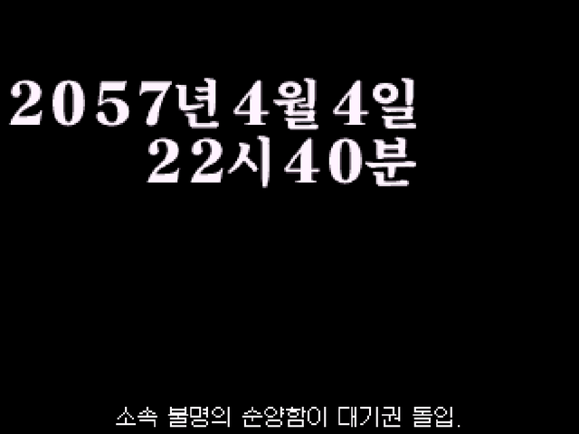
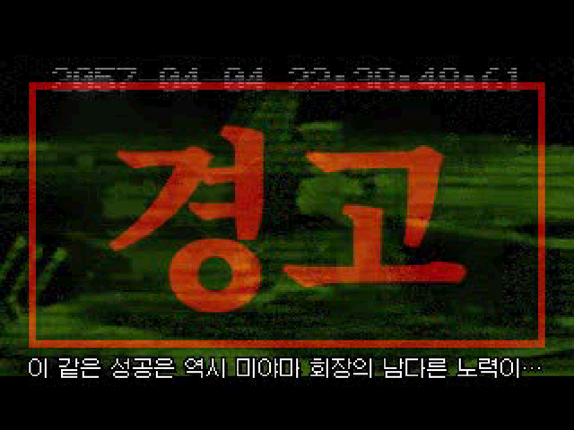
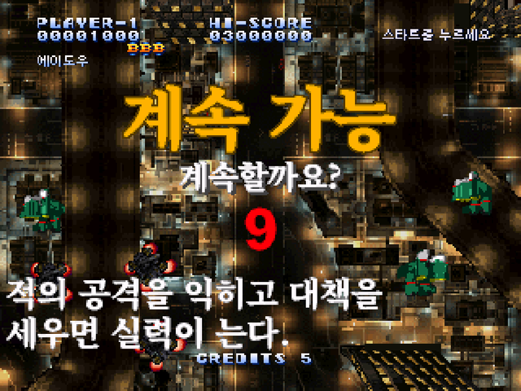

# 창궁홍련대 황무출격 — PS1 한글 패치 v1.0

1996년 라이징(RAIZING)이 만든 세로 슈팅 게임 **蒼穹紅蓮隊 黄武出撃**(창궁홍련대 황무출격)의 PS1 일본판(SLPS-01172)을 우리말로 옮긴 비공식 팬 패치입니다.

거대 기업이 군대를 거느리고 서로 싸우는 2057년, 주식회사 진성의 사설 부대 「창궁홍련대」의 조종사가 되어 정체불명의 테러 집단과 맞서는 이야기입니다. 이야기 대부분이 작전 설명 음성과 신문·동영상으로 전해지는데, 이 패치는 그 모든 것을 한국어로 즐길 수 있게 하는 데 집중했습니다.

**목표는 '일본어 0개'.** 메뉴부터 신문 본문 한 줄, 동영상 속 글자까지 모두 한글로 바꿨습니다(스태프 이름만 원작 그대로).

**[⬇ 패치 내려받기 (v1.0)](https://github.com/kanx030/soukyuu-gurentai-ps1-kr/releases/tag/v1.0)** · 적용 방법은 [아래](#패치하는-법)를 보세요.

## 특징

### 🗣 한국어 음성 + 모든 음성에 한글 자막
- 오퍼레이터 무전 69줄, 오프닝·클리어·엔딩 동영상의 해설과 대사를 **한국어로 새로 녹음**했습니다.
- 설정의 '음성'에서 **한국어 / 일본어**를 고를 수 있고, 어느 쪽을 골라도 **모든 음성에 한글 자막**이 나옵니다.
- 한국어 음성은 ElevenLabs 목소리 설계(Voice Design)로 새로 만든 목소리이며, 원작 성우의 목소리를 복제하지 않았습니다.

| 작전 설명 | 보스 소개 |
|---|---|
|  |  |

### 📰 화면 속 일본어 전부 한글화
- 한글 타이틀 로고, 메뉴·설정·기체 선택·결과·이어하기 화면, 엔딩 문장.
- **신문**: 제목은 물론 본문·소제목·광고·날짜 줄까지 한국어로 다시 찍었습니다.
- **동영상**: 화면에 찍혀 있던 글자(경고, 영상 자료, 날짜, 신문, 스태프 직책)를 영상 속에서 직접 한글로 바꿨습니다.
- 작은 글자와 자막에는 도트 글꼴 **갈무리(Galmuri)**를 써서 PS1 해상도에서도 또렷하게 읽힙니다.

| 오프닝 동영상 | 신문 |
|---|---|
|  |  |
| **엔딩** | **이어하기** |
|  |  |

### 📚 새턴판의 장점 이식
- **자료실**: 메뉴에서 △. 새턴판에만 있던 설정 자료 18쪽에 황무·조종사 쪽을 더해 모두 26쪽.
- **연습 모드**: 1~7면을 골라 연습하고, 면별 최고 점수를 메모리카드에 기록합니다.

| 자료실 | 연습 모드 최고 점수 |
|---|---|
|  |  |

### 🎮 일시정지 치트 메뉴
- 게임 중 START로 일시정지하면 **무적 / 폭탄 무한 / 컨티뉴 무한**을 켜고 끌 수 있습니다(↑↓ 고르기, ○ 켬/끔, 저장되지 않음).

## 음성 샘플
눌러서 내려받아 들어 보세요(m4a).

| 샘플 | 길이 |
|---|---|
| [1면 작전 설명 — 오퍼레이터](samples/voice_stage1_briefing.m4a) | 16초 |
| [오프닝 — 특집 방송 해설](samples/voice_opening_narration.m4a) | 42초 |
| [오프닝 — 긴급 무전](samples/voice_opening_operator.m4a) | 13초 |
| [엔딩 — 해설](samples/voice_ending_narration.m4a) | 60초 |

## 표기 기준
- 사람·보스 이름은 일본어 발음(예: 야시다 카오루, 코쿠베츠), 회사·용어는 한자음(예: 팔복성간개발공사, (주)진성).
- 플레이어 기체: 도룡·자전·붕아·황무. 조준망: 핀포인트·에이도우·올레인지·보오류·무소우·랜덤·호우센·오우카.
- 원작의 영어 표시(PLAYER-1, HI-SCORE, CREDITS 등)와 스태프 이름은 원작 그대로 두었습니다.
## 원본 롬 정보
패치는 아래 원본에만 맞습니다. 다른 판(다른 지역판·다른 덤프)에는 적용되지 않습니다.

| 항목 | 값 |
|---|---|
| 제목 | 蒼穹紅蓮隊 黄武出撃 (Soukyuu Gurentai Oubu Shutsugeki) |
| 기종 / 지역 | PlayStation / 일본 |
| 제품 번호 | SLPS-01172 |
| 구성 | CD 1장, 트랙 32개 (데이터 1 + 음악 31) |

**한 파일로 합친 bin (패치 대상, 트랙 32개 전부)**

| 항목 | 값 |
|---|---|
| 크기 | 380,772,336 바이트 |
| CRC32 | `7366DF27` |
| MD5 | `839C305E52D16933F434701EAE03C652` |
| SHA-1 | `21C32C1BA110AA7393A3BB28D93D3F5C604E6D80` |

**참고: 1번 데이터 트랙만 (Track 01, MODE2/2352)**

| 항목 | 값 |
|---|---|
| 크기 | 274,511,328 바이트 |
| CRC32 | `1B1559D4` |
| MD5 | `DC0D8E4DAF2A83E826816A81F91D3E17` |
| SHA-1 | `8E4DF26BF94B5F9A2C29B95F5EA43CE7DEC8A02C` |

트랙별로 나뉜 bin(Redump 형식)을 가지고 있다면 한 파일로 합쳐야 합니다. 예: CDMage, binmerge(`binmerge 원본.cue ps1_j`), 또는 chd로 바꾼 뒤 아래처럼 풀기.

## 패치하는 법
1. 일본판 디스크를 **한 개의 bin + cue**로 준비합니다.
   - chd라면: `chdman extractcd -i "Soukyuu Gurentai (J).chd" -o ps1_j.cue -ob ps1_j.bin`
   - 준비한 bin의 MD5가 위 표의 `839C305E…`와 같은지 확인하세요.
2. [xdelta UI](https://www.romhacking.net/utilities/598/) 또는 xdelta3로 패치를 적용합니다.
   - `xdelta3 -d -s ps1_j.bin sgkr_v1.0.xdelta sgkr.bin`
   - 패치 결과 `sgkr.bin` 확인값: 크기 662,259,696 바이트, MD5 `C71DF553EAA5D3C36931C94872FBDCBC`
3. 함께 올린 `sgkr.cue`를 `sgkr.bin`과 같은 폴더에 두고 cue 파일로 실행합니다.

SwanStation(RetroArch)에서 확인했습니다. DuckStation 등 다른 에뮬레이터와 실제 PS1 기기에서는 아직 확인하지 않았습니다.

## 알려진 점
- 한국어 음성을 넣느라 음악 트랙이 늘어나 패치 결과는 트랙 63개, 약 632MB입니다.
- 신문 본문의 아주 작은 글자는 원래도 읽을 수 없는 크기라, 같은 기사 내용의 한국어 글로 채웠습니다.
- 2P 쪽 치트는 1P와 같은 방식이지만 직접 확인하지는 않았습니다.
- 메모리카드 저장 형식은 원작과 같아서 기존 세이브를 그대로 쓸 수 있습니다.

## 저작권
- 원작 © 1996 RAIZING / 8ing, Data East. 이 패치에는 게임 자료가 들어 있지 않으며, 원본 디스크는 직접 준비해야 합니다.
- 글꼴: Galmuri © Lee Minseo (quiple), Noto Sans KR / Noto Serif KR © Google, 송명·나눔손글씨 붓 — 모두 SIL Open Font License 1.1.
- 한국어 음성: ElevenLabs 목소리 설계로 만든 합성 음성.
- 이 패치는 비영리 팬 번역입니다.
